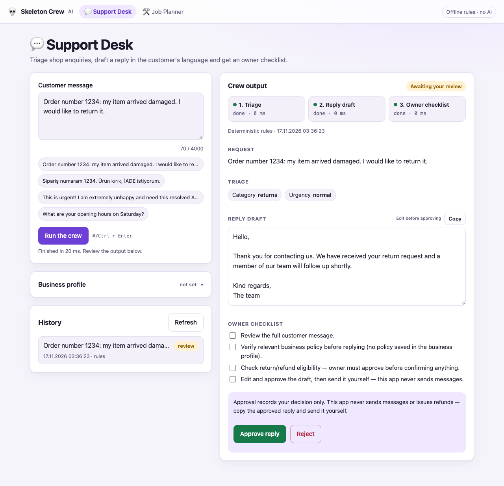

# 💀 Skeleton Crew AI

**One lean skeleton. A crew for every small-business inbox.** · Kiroween 2026 · Skeleton Crew category

Small shops and trades get the same messages every day: *"my order arrived broken"*, *"the shop door won't close, can you come today?"*. Skeleton Crew AI is a dependency-free starter for apps where a small crew of specialist steps turns such a request into a reviewed next step. You approve, edit or reject. The app never sends, books, refunds or charges anything itself.

Two distinct apps ship on the same skeleton:

| | Support Desk 💬 | Job Planner 🛠️ |
|---|---|---|
| Input | customer email / chat message | service or repair request |
| Steps | Triage → Reply draft → Owner checklist | Scope → Work plan → Questions |
| Output | category, urgency, editable reply in the customer's language, checklist | job type, provisional tasks, missing details, questions; never a booking or price |



**Try it:** [public demo](https://skeleton-crew-ai-demo.jauntybag4.chatgpt.site/) (deterministic rules in your browser, no AI) · or run it locally with free local AI (below).

## Why it's a skeleton, not two demos

Each app is **one folder and one manifest**. The shared core (`src/`) never mentions an app; a test fails if it does.

```js
// apps/job-planner/manifest.js
export default defineApp({
  id: 'job-planner', route: 'planner', title: 'Job Planner',
  samples: ['Please repair our broken shop door at 14 High Street.'],
  steps,   // [{ name, label, run, schema, instructions }]
  view: [
    { type: 'fields', step: 'scope', title: 'Scope', fields: [['service', 'Job type']] },
    { type: 'list', step: 'planner', field: 'tasks', title: 'Provisional work plan', checklist: true },
  ],
});
```

From that manifest the skeleton provides: HTTP routes, a UI page with step timeline, history and review, output validation, the offline runner, the local-model runner (each step's `schema` becomes the model's JSON schema), MCP tools, the static public demo, and tests.

Add a third app in one command:

```sh
npm run new-app review-responder "Review Responder"
npm test          # the new app is already covered by the generic registry tests
npm run start:web # → http://127.0.0.1:3000/review-responder
```

## Quick start

Requires Node.js 22+. No `npm install`, no API keys.

```sh
npm test              # 145 offline tests
npm run start:web     # http://127.0.0.1:3000 — both apps, offline rules
npm run demo:support  # CLI demos
npm run demo:planner
npm run build:demo    # static public demo → dist/public-demo
```

### Free local AI (optional)

Install [Ollama](https://ollama.com/download), then:

```sh
ollama pull qwen3:1.7b
npm run start:free    # starts Ollama if needed and switches both apps to live mode
```

Model calls go only to `127.0.0.1:11434`: three calls per run, 120 s per call, no retries. Every model output must pass the same step schema as the rules or the run fails visibly, and it never falls back to rules silently. A small local model makes mistakes, so review every draft. Measured on an Apple M3 with 16 GB RAM: a run took about 40–50 s. Re-measure on your machine.

## What's inside

```text
src/            the skeleton: registry, schema, runtime, live runner, lifecycle, store, server, ui/
apps/<id>/      one folder per app: workflow.js (steps), manifest.js, fixtures.js, demo.js
apps/index.js   the registry — one line per app
scripts/        new-app scaffolder, public-demo build, MCP server, Ollama launcher
.kiro/          steering, specs, hooks and MCP config used to build this
test/           node:test suites
```

- **Business profile:** an optional profile (name, policies, hours, service area) shared by all apps. Drafts sign with your name, checklists cite your policy and plans check your service area.
- **Human review, enforced:** results are versioned; stale or repeated decisions are rejected (409). Failed runs have no outputs to approve.
- **Safe by default:** loopback-only server, strict CSP, no inline scripts, cross-origin POSTs blocked, untrusted text rendered as text.

Details: [docs/architecture.md](docs/architecture.md).

## Built with Kiro

`.kiro/` contains the steering files, specs (`app-registry`, `two-app-mvp`, `business-agent-workflow`), hooks (tests on save, manifest guard, keep `.kiro` tracked, *new app from an idea*), and an MCP config that exposes this project's own tools (`list_apps`, `run_workflow`, `validate_output`, `scaffold_app`) to Kiro via `npm run mcp`. What was done in Kiro and what was done with other assistants is recorded honestly in [docs/kiro-usage.md](docs/kiro-usage.md).

## Limits

Single-user local tool: no auth, rate limiting or multi-process storage. The public demo is rules only. Offline rules are keyword-based and English/Turkish only. Approvals record decisions; nothing is sent.

MIT licensed. Ollama and Qwen are third-party software with their own licenses.
