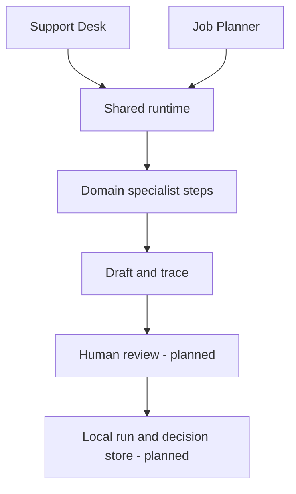

# Architecture

Customer request → coordinator → triage → reply draft + operations checklist → human review.

The initial implementation is deterministic and runs entirely offline. No model, database, deployment, or external integrations are configured. Future adapters must preserve review-before-send and keep customer data out of logs.

## Shared runtime and application boundaries

Current runtime: `src/runtime.js` executes named pure steps sequentially and records their order. `apps/support-desk/` wraps the existing `src/crew.js` through that runtime; `apps/job-planner/` defines scope, planning and clarification steps. Existing source files and tests are retained. All current results are synthetic deterministic drafts; no database, server or model adapter exists yet.

## Planned web MVP
Keep Node.js ES modules and native tests. Add one local HTTP server and two separate application frontends, sharing runtime and review components. Prefer plain HTML/CSS/JS until complexity justifies a framework. Serve app-specific routes `/support` and `/planner`; never expose provider credentials to browser code.

Proposed API: `POST /api/runs` with `{appId, request, mode}`, `GET /api/runs/:id`, `POST /api/runs/:id/reviews` with `{decision, editedDraft, expectedVersion}`. Server generates IDs and timestamps. Run: `{id, appId, mode, status, version, outputs, trace, error?}`; review: `{runId, decision, editedDraft, createdAt, version}`. Use statuses `running`, `awaiting_human_review`, `approved`, `rejected`, `failed`. Approve/reject requires matching version and a pending draft; conflicting or duplicate transitions return 409.

Start with an injectable in-memory store; add atomic local JSON persistence under ignored `data/` for the single-user demo. Validate records on load and report corruption; never silently overwrite broken data. No cross-process or multi-tenant guarantees. Keep persistent schema versioned.

Provider interface (planned): `generate({role,input,context,signal})` returns validated structured output. Deterministic fixtures are the default adapter; a real provider will be chosen and documented in T5. Limit request to 4,000 characters, bound output size, timeout each live call after 15 seconds and cap a run at three specialist calls with no automatic retries initially. Treat user/model text as data, not tool instructions. Invalid outputs/timeouts fail the run and disable approval. Do not silently substitute offline output for a failed live call.

Tests must cover both apps, validation, step failure, provider schema rejection/timeouts, review conflicts, persistence reload and secret-free logs. Avoid full input/output logging. Store only synthetic demo data by default.

## Local AI provider

Ollama is the recommended free runtime, listening on loopback only. Its chat endpoint uses non-streaming schema-constrained responses; the application independently validates domain fields. Each local call has a 120-second timeout (the cloud adapter retains 15 seconds); each run has at most three calls and no retries. This supersedes the earlier universal 15-second timeout proposal for local inference. Local inference requires the laptop and model service to be running; public offline demos remain independent.
