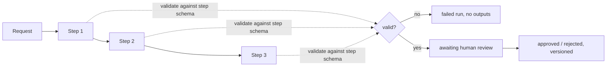

# Architecture

```text
apps/<id>/workflow.js ─┐ steps: name · label · run(text, outputs, ctx) · schema · instructions
apps/<id>/manifest.js ─┤ defineApp({ id, route, title, samples, steps, view })
apps/index.js ─────────┘ createRegistry([...])            ← one line per app
            │
            ▼
src/registry.js   validates manifests (ids, routes, schemas, view ↔ schema references)
src/runtime.js    offline: run steps in order, validate each output, timed trace
src/live-workflow.js  live: one provider per run, same schemas, explicit failure
src/lifecycle.js  makeRun · applyReview · validateProfile  (shared with the browser demo)
src/store.js      MemoryStore · JsonStore (atomic temp-file + rename)
src/server.js     /, /<route>, /assets/*, /api/apps, /api/runs[?appId], /api/runs/:id[/review]
src/ui/           pages.js (HTML shell + data-only config) · client.js · styles.css
```



## The skeleton boundary

`src/` never names an application, step or domain field; `test/registry.test.js` fails if it does. The server, live runner, browser UI, MCP server and public build all iterate over the registry. Adding an app is `npm run new-app <id> "<Title>"`, which writes `apps/<id>/` and one registry line; the generic tests then cover it.

## One contract, three modes

| Mode | Where | Steps | Storage |
|---|---|---|---|
| Public demo | visitor's browser | deterministic rules | localStorage |
| Local offline | Node server | deterministic rules | `data/runs.json` |
| Local live | Node server → Ollama on 127.0.0.1 | model, 3 calls max | `data/runs.json` |

The same step schema validates rule output and model output. The browser demo imports the same `runtime`, `registry` and `lifecycle` modules as the server, so the review rules cannot drift.

## Review lifecycle

`awaiting_human_review | failed → approved | rejected`. Review requires the current `version`; stale or repeated decisions return 409. `editedDraft` must be a string ≤ 8,000 characters or null. Failed runs store no outputs and cannot be approved. Approval performs no external action.

## Trust boundaries

- Customer text and earlier step outputs are untrusted data (user message only).
- Step instructions, schemas and the owner's business profile are trusted (system messages).
- Pages use a strict CSP (no inline scripts); untrusted text is rendered with `textContent`.
- The server binds to 127.0.0.1, blocks cross-origin POSTs, limits bodies to 16 KB and never returns internal error text.

## Known limits

No authentication, multi-user isolation, rate limiting or job queue: the Node server is a single-user local tool. JsonStore rewrites the whole file and is not multi-process safe. Local model quality and start-up reliability depend on the machine and must be re-measured before any demo.
